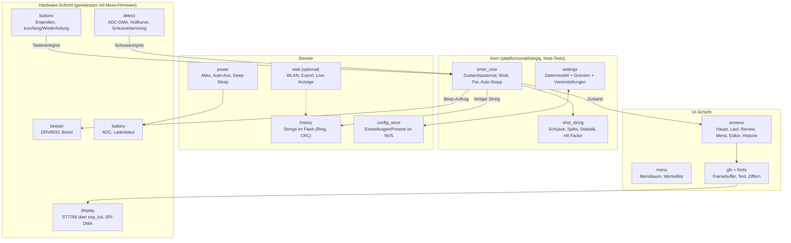
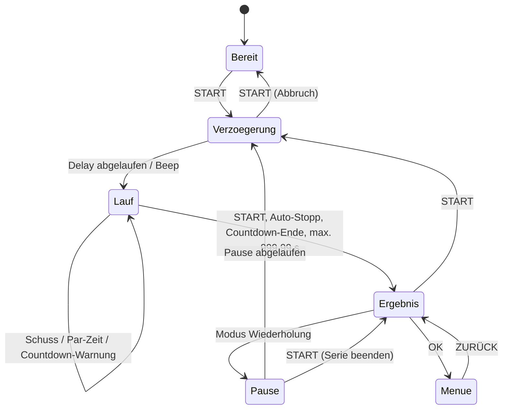

# Shot Timer – Firmware-Architektur

| | |
|---|---|
| **Dokument** | Architektur der Timer-Firmware (Gerätesoftware) |
| **Version** | 0.3 (Entwurf) – M1 und M2 umgesetzt |
| **Datum** | 2026-10-26 |
| **Bezug** | [ANFORDERUNGEN.md](ANFORDERUNGEN.md) v0.2, [HARDWARE_KONZEPT.md](HARDWARE_KONZEPT.md) v0.2, Mess-Firmware [`firmware/mess`](../firmware/mess) |
| **UI-Prototyp** | [`docs/ui-prototyp.html`](ui-prototyp.html) – klickbarer Simulator von Display und Tasten (online: https://claude.ai/artifact/Wt1kxmGZ3CRdpYLcE5ey93) |

---

## 1. Grundsätze

1. **Zeitkritisches zuerst:** Schusserkennung und Beep laufen unabhängig von Display, Menü, Speicher und Funk (N-041). Eine langsame Displayausgabe oder ein Flash-Zugriff darf nie einen Schuss oder dessen Zeitstempel kosten.
2. **Plattformunabhängiger Kern:** Zustandsautomat, Modi, Par-Logik, Statistik und Hit Factor sind reines C ohne ESP-IDF-Abhängigkeiten. Sie werden auf dem PC mit Unit-Tests geprüft, bevor sie auf das Gerät kommen.
3. **Wiederverwendung:** Schusserkennung (`envelope`), Beep-Treiber und Speicherschicht stammen aus der Mess-Firmware. Sie werden in gemeinsame Komponenten ausgelagert, damit beide Firmwares denselben Code nutzen.
4. **Keine Pflicht-Abhängigkeit von Smartphone oder WLAN** (F-070). Funk ist standardmäßig aus (F-084).
5. **ESP-IDF über PlatformIO**, wie die Mess-Firmware. Display über den in ESP-IDF enthaltenen `esp_lcd`-Treiber (ST7789). Es gibt keine externen Bibliotheken, die erst aus einem Registry geladen werden müssen.

---

## 2. Schichten und Module



---

## 3. Tasks (FreeRTOS)

| Task | Kern | Priorität | Takt | Aufgabe |
|---|---|---|---|---|
| `detect` | 1 | höchste (max−2) | DMA-Rahmen alle 3,2 ms | ADC lesen, Hüllkurve, Schusserkennung, Zeitstempel |
| `timer` | 0 | hoch | ereignisgesteuert + 1-ms-Timer für Delay/Par | Zustandsautomat, Beep-Aufträge, String führen |
| `ui` | 0 | mittel | bei Änderung, max. 30 Bilder/s | Bildschirm zeichnen, Framebuffer per SPI-DMA senden |
| `buttons` | 0 | mittel | 5 ms | Entprellen, kurz/lang/Wiederholen erkennen |
| `store` | 0 | niedrig | ereignisgesteuert | Strings und Einstellungen schreiben (blockiert nie den Timer) |
| `power` | 0 | niedrig | 1 s | Akkuspannung, Auto-Aus, Dimmen |
| `web` | 0 | niedrig | – | nur wenn WLAN eingeschaltet |

Kommunikation nur über **Queues** (Ereignisse) und einen **Zustands-Schnappschuss** (`timer_view_t`), den die UI unter einem Mutex kopiert. Die UI ruft nie Kernfunktionen direkt auf, sondern schickt Tastenereignisse an den `timer`-Task.

---

## 4. Zeitbasis und Genauigkeit

- **Gemeinsame Zeitbasis:** `esp_timer_get_time()` in µs.
- **Startzeitpunkt:** Der `timer`-Task startet den Beep (LEDC) und nimmt unmittelbar davor den µs-Zeitstempel. Dieser Zeitpunkt ist t = 0 des Strings.
- **Schusszeitpunkt:** `detect` kennt für jeden DMA-Rahmen den µs-Zeitpunkt seines letzten Samples. Jedes Sample liegt 50 µs vor dem nächsten. Der Zeitstempel des Schusses ist das erste Sample über der Schwelle.
- **Fehlerbudget:**

| Quelle | Fehler |
|---|---|
| Abtastraster 20 kS/s | ≤ 0,05 ms |
| Zuordnung DMA-Rahmen ↔ µs (Interrupt-Latenz) | ≤ 0,1 ms |
| Beep-Start (Software-Latenz zwischen Zeitstempel und LEDC) | ≤ 0,05 ms |
| Anstieg der Hüllkurve bis zur Schwelle | ≤ 0,3 ms (abhängig vom Pegel) |
| Schalllaufzeit Mündung → Mikrofon (0,5–1 m) | 1,5–3 ms (physikalisch, bei allen Timern gleich, wird nicht korrigiert) |
| **Summe Elektronik** | **< 0,5 ms**, Anforderung F-034: ±10 ms |

- Anzeige auf 0,01 s, intern 1 µs-Auflösung. Gespeichert wird in **0,1 ms** (uint32, reicht bis 119 h).

---

## 5. Zustandsautomat



- **Bereit** und **Ergebnis** sind derselbe Hauptbildschirm. Er zeigt den letzten String bzw. „0.00“, wenn noch keiner existiert.
- **Spy-Modus:** START wechselt ohne Beep direkt in **Lauf**, t = 0 ist der Tastendruck.
- **Trockentraining:** wie Standard, aber `detect` ist stumm geschaltet. Der String endet nach der letzten Par-Zeit.
- **Menü, Editor, Historie** sind UI-Zustände. Sie sind nur aus **Bereit/Ergebnis** erreichbar; während Verzögerung und Lauf sind sie gesperrt.

### 5.1 Ereignisse an den Kern

| Ereignis | Quelle | Daten |
|---|---|---|
| `EV_KEY` | buttons | Taste, kurz/lang/Wiederholung |
| `EV_SHOT` | detect | Zeitstempel µs, Spitzenpegel dBFS, Anstiegszeit |
| `EV_TICK` | 1-ms-Timer (nur in Verzögerung/Lauf/Pause aktiv) | aktuelle Zeit µs |
| `EV_SETTINGS` | menu | geänderte Einstellungen |

Der Kern gibt **Aktionen** zurück (Beep starten mit Ton/Dauer, Erkennung ein/aus/Schwelle, String speichern, UI neu zeichnen). Dadurch ist er ohne Hardware testbar: Ein Test füttert Ereignisse mit erfundenen Zeitstempeln und prüft die Aktionen.

---

## 6. Modi

| Modus | Start | Ende | Besonderheiten | Anforderung |
|---|---|---|---|---|
| **Standard** | Verzögerung → Beep | START, Auto-Stopp | – | F-060 |
| **Par** | wie Standard | wie Standard | 1–10 Par-Zeiten (kumuliert ab Beep), je ein Par-Beep; Schüsse nach der letzten Par-Zeit werden markiert | F-061, F-020–F-023 |
| **Spy** | START, kein Beep | START, Auto-Stopp | misst fremde Schützen | F-062 |
| **Trockentraining** | wie Standard | nach letzter Par-Zeit | keine Schusserkennung; optional n Wiederholungen mit Pause | F-063 |
| **Wiederholung** | wie Standard | wie Standard, danach Pause und automatisch nächster Durchgang | Pause 3–60 s; START während der Pause beendet die Serie | F-064 |
| **Countdown** | wie Standard | nach Ablauf der Zeit (Ende-Beep) | Warn-Beeps (z. B. 10 s und 5 s vor Ende); Anzeige der Restzeit | F-065 |

**Gemeinsame Parameter:** Startverzögerung (Zufall von–bis, fest, sofort), Beep (Ton, Dauer, Lautstärke), Empfindlichkeit, Echo-Zeit, Auto-Stopp.

**Presets (F-069):** Ein Preset ist ein benannter Satz aus Modus + Verzögerung + Par-Zeiten + modusspezifischen Parametern. Es gibt 10 Speicherplätze.

**Hit Factor (F-068):** Nach einem String unter *Menü → Letzter String → Wertung*: A/C/D/Miss/No-Shoot zählen, Power Factor Minor/Major. Formel: HF = Punkte ÷ Gesamtzeit. Punkte Minor A5/C3/D1, Major A5/C4/D2, Miss und No-Shoot je −10. Das Ergebnis wird beim String gespeichert.

---

## 7. Bedienkonzept

| Taste | Hauptbildschirm (Bereit/Ergebnis) | Verzögerung/Lauf | Menü | Werteditor |
|---|---|---|---|---|
| **START** kurz | neuer String | Abbruch bzw. Stopp | – | – |
| **START** 2 s | Ausschalten | – | Ausschalten | – |
| **▲ / ▼** | durch die Schüsse des Strings blättern | – | Auswahl bewegen | Wert ändern (halten = schneller) |
| **OK** | Menü öffnen | – | Untermenü öffnen / Wert bearbeiten | übernehmen |
| **ZURÜCK** | Schnelleinstellung Empfindlichkeit | – | eine Ebene zurück | verwerfen |
| **ZURÜCK** 1 s | – | – | direkt zum Hauptbildschirm | – |

Damit sind die häufigsten Aktionen mit höchstens 2 Tastendrücken erreichbar (F-073): neuer String (1), Schüsse ansehen (1), Empfindlichkeit (1 + ▲▼), Modus (OK, OK).

**Einschalten:** START drücken weckt das Gerät aus dem Deep-Sleep. Der zuletzt verwendete Modus und das letzte Ergebnis werden angezeigt.

---

## 8. Bildschirme (320 × 240, quer)

Aufbau aller Bildschirme: **Statuszeile** (20 px: Modus, Empfindlichkeit, Akku), **Inhalt**, **Hinweiszeile** (18 px: was die Tasten gerade tun). Im Lauf entfällt die Hinweiszeile zugunsten größerer Ziffern.

| Bildschirm | Inhalt |
|---|---|
| Hauptbildschirm | große Zeit des gewählten Schusses (Standard: letzter Schuss = Gesamtzeit), „Schuss 7/10“, Split, 1. Schuss; darunter Gesamt, Ø-Split, schnellster Split; Par-Überschreitung rot |
| Verzögerung | „Bereit“ + Fortschrittsanzeige (ohne die Restzeit zu verraten, bei Zufallsstart) |
| Lauf | laufende Zeit klein, letzter Schuss groß, Schussnummer und Split; Par-Marken |
| Countdown | Restzeit groß, Schusszahl |
| Menü | Liste mit Auswahlbalken, Werte rechtsbündig, Scrollbalken |
| Werteditor | Name, Wert groß, Grenzen, ▲▼-Hinweis |
| Historie | Liste: Nr., Modus, Schüsse, Gesamtzeit; OK öffnet den String im Hauptbildschirm-Layout |

Der klickbare Prototyp [`docs/ui-prototyp.html`](ui-prototyp.html) setzt genau dieses Konzept um und ist die Vorlage für die Geräte-UI.

**Schrift:** zwei Bitmap-Schriften (16 px und 24 px, deutsche Umlaute) und ein großer Ziffernsatz (ca. 72 px) für Zeiten. Sie werden mit einem Python-Skript aus einer freien Schrift erzeugt und als C-Arrays eingebunden.

**Framebuffer:** 320 × 240 × 16 bit = 150 KB. Das ist für den internen RAM zu groß. Deshalb wird **zeilenstreifenweise** gezeichnet (z. B. 320 × 40 px = 25 KB, doppelt gepuffert für SPI-DMA). Bei Modulen mit PSRAM (N16R8) kann ein ganzer Framebuffer im PSRAM liegen.

---

## 9. Datenhaltung

### 9.1 Einstellungen und Presets (NVS)

- Eine `settings_t`-Struktur mit **Versionsnummer**, als Blob im NVS-Namespace `timer`.
- Beim Laden: Version prüfen; unbekannte oder ältere Versionen werden migriert oder auf Werkseinstellungen gesetzt; jeder Wert wird auf seine Grenzen begrenzt.
- Presets: 10 Blobs `preset0`–`preset9`.
- Geschrieben wird erst beim Verlassen des Menüs (Flash schonen).

### 9.2 Strings (Historie)

- Eine Datei `strings.bin` auf der Speicherpartition, **Ring aus 200 Datensätzen fester Länge** (F-050: ≥ 100).
- Datensatz (ca. 640 Byte):

| Feld | Typ | Inhalt |
|---|---|---|
| `magic`, `version` | u16, u16 | Kennung, Formatversion |
| `seq` | u32 | fortlaufende Nummer (größte = neueste) |
| `timestamp` | u32 | Unixzeit, falls bekannt (WLAN/App), sonst 0 |
| `mode`, `flags` | u8, u8 | Modus; Bits: Par aktiv, Wertung vorhanden, abgebrochen … |
| `delay_ms`, `par_ms[10]` | u32 | verwendete Verzögerung, Par-Zeiten |
| `n_shots` | u8 | Anzahl Schüsse (≤ 99) |
| `shot_t[99]` | u32 | Zeiten in 0,1 ms ab Beep |
| `shot_db[99]` | i8 | Spitzenpegel in dBFS (für die Auswertung von Fehlerkennungen) |
| `score` | 5 × u8 + u8 | A, C, D, Miss, NS, Power Factor |
| `crc32` | u32 | über den gesamten Datensatz |

- Beim Start werden alle Datensätze gelesen. Gültig ist ein Datensatz mit korrektem CRC; der mit dem höchsten `seq` ist der neueste, der nächste Schreibplatz folgt darauf. Ein Stromausfall beim Schreiben macht höchstens diesen einen Datensatz ungültig.
- **Letzten Schuss löschen** (F-042) schreibt den Datensatz mit neuem CRC an dieselbe Stelle.

### 9.3 Partitionstabelle (8 MB)

| Partition | Größe | Inhalt |
|---|---|---|
| nvs | 24 KB | Einstellungen, Presets |
| otadata | 8 KB | für OTA-Updates (F-083) |
| app0 / app1 | je 2 MB | Firmware (OTA im Wechsel) |
| storage | ca. 3,9 MB | Historie, optional Messmitschnitte |

---

## 10. Energieverwaltung

| Zustand | Display | ESP32 | Übergang |
|---|---|---|---|
| Aktiv | volle Helligkeit | 80–160 MHz | jede Taste, jeder Schuss |
| Gedimmt | 20 % | aktiv | 60 s ohne Bedienung (nicht während Lauf) |
| Aus | aus, Sleep-Befehl | Deep-Sleep, Analogteil und Boost stromlos | Auto-Aus nach 5–60 min (einstellbar) oder START 2 s |

- Vor dem Deep-Sleep: offenen String speichern, Einstellungen sichern.
- Akku < 3,4 V: Warnsymbol; < 3,3 V: speichern und ausschalten (N-023, Kap. 6 im Hardware-Konzept).

---

## 11. Ordnerstruktur

```
firmware/
├── components/              gemeinsam genutzt von mess und timer
│   ├── envelope/            ADC-DMA, Hüllkurve, Schusserkennung
│   ├── beeper/
│   └── board/               board_pins.h
├── mess/                    Mess-Firmware (bindet components/ ein)
└── timer/                   Timer-Firmware
    ├── platformio.ini, CMakeLists.txt, partitions.csv, sdkconfig.defaults
    ├── src/
    │   ├── main.c           Start, Tasks anlegen
    │   ├── core/            timer_core.c, shot_string.c, settings.c  (ohne ESP-IDF)
    │   ├── ui/              screens.c, menu.c, gfx.c, fonts/*.c
    │   ├── hal/             display.c, buttons.c, battery.c
    │   └── svc/             history.c, config_store.c, power.c, web.c
    └── test/                Host-Tests für src/core (gcc, ohne Hardware)
tools/
└── make_font.py             erzeugt fonts/*.c aus einer TTF-Datei
```

---

## 12. Teststrategie

| Ebene | Werkzeug | Was |
|---|---|---|
| Kern | Host-Tests (gcc, `make test`) | Zustandsübergänge aller Modi, Par-Beeps, Auto-Stopp, Statistik, Hit Factor, Grenzwerte der Einstellungen, Ring der Historie |
| UI | Prototyp im Browser, später Screenshots vom Gerät | Layout, Lesbarkeit, Tastenbelegung |
| Hardware | Testmodus auf dem Gerät (N-045) | Beep, Tasten, Display, Mikrofonpegel, Akku |
| System | Abnahmetests A-01 bis A-09 aus dem Lastenheft | Genauigkeit, Splits, Stand indoor/outdoor, Laufzeit |

Die Host-Tests sollen später in GitHub Actions laufen. Dort wird auch die Firmware gebaut.

---

## 13. Umsetzungsplan

| Meilenstein | Inhalt | braucht Hardware? |
|---|---|---|
| **M1** | Kern (`timer_core`, `shot_string`, `settings`) mit Host-Tests | nein |
| **M2** | Gemeinsame Komponenten aus der Mess-Firmware auslagern; Timer-Projektgerüst, das kompiliert | nein |
| **M3** | Display-Treiber, Schriften, Bildschirme und Menü nach Prototyp | Display zum Testen |
| **M4** | Integration Erkennung + Beep + Tasten → erster echter String | Phase-2-Aufbau |
| **M5** | Historie, Presets, Einstellungen speichern | nein |
| **M6** | Energieverwaltung, Deep-Sleep, Akkuanzeige | Phase-3-Aufbau |
| **M7** | Abstimmung der Erkennung mit den Messwerten vom Stand | Messdaten |
| **M8** (optional) | WLAN: Export, Live-Anzeige, OTA | nein |

---

## 14. Entscheidungen

| Frage | Entscheidung (2026-10-26) |
|---|---|
| Laufbildschirm | Zeit des letzten Schusses groß, laufende Uhr klein (wie im Prototyp) |
| Empfindlichkeit | Skala 1–10, 10 = am empfindlichsten (Schwelle −6 … −40 dBFS) |
| Sprache | nur Deutsch in V1 |

## 15. Stand der Umsetzung

| Meilenstein | Stand |
|---|---|
| M1 Kern mit Host-Tests | **erledigt**: `firmware/timer/src/core` (`settings`, `shot_string`, `timer_core`), Tests in `firmware/timer/test` (`make -C firmware/timer/test`), laufen in GitHub Actions |
| M2 Gemeinsame Komponenten, Projektgerüst | **erledigt**: `firmware/components` (board, envelope, beeper), `firmware/timer` baut und läuft mit START-Taste, Schusserkennung und Beep; Anzeige und Einstellungen vorerst über die serielle Konsole ([Anleitung](../firmware/timer/README.md)) |
| M3–M8 | offen |
