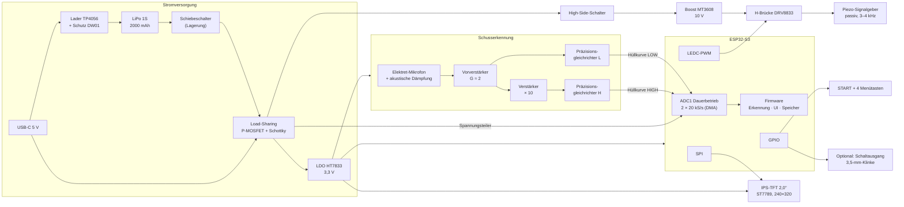

# Shot Timer auf ESP32-Basis – Hardware-Konzept

| | |
|---|---|
| **Dokument** | Hardware-Konzept (Grundlage für Prototyp und Schaltplan) |
| **Version** | 0.1 (Entwurf) |
| **Datum** | 2026-10-25 |
| **Bezug** | [ANFORDERUNGEN.md](ANFORDERUNGEN.md) v0.2 |
| **Einsatzschwerpunkt** | IPSC-Training in der Halle und am Stand mit mehreren Schützen |

---

## 1. Auslegungsziele

Aus dem Einsatzschwerpunkt folgen die Prioritäten der Hardware:

1. **Eigene Schüsse sicher von Schüssen auf den Nachbarbahnen trennen.** In der Halle sind Nachhall und Nachbarschüsse die häufigste Ursache für Fehlmessungen. Das Mikrofon und die Eingangsstufe dürfen beim eigenen Schuss nicht so stark übersteuern, dass ein lauter Nachbarschuss gleich groß erscheint. → **Großer Dynamikbereich der Eingangsstufe** ist die wichtigste Hardware-Anforderung (Kap. 4).
2. **Lauter Startbeep** unter doppeltem Gehörschutz und bei Lärm von den Nachbarbahnen (≥ 100 dB(A) in 30 cm).
3. **Gut ablesbares Display** in einer dunklen Halle und am Außenstand.
4. **Ein Trainingstag mit einer Akkuladung**, Laden über USB-C.
5. **Materialkosten ≤ 40 €**, nur Module und Bauteile, die sich von Hand löten lassen.

---

## 2. Blockschaltbild



---

## 3. Komponentenauswahl

### 3.1 Mikrocontroller: ESP32-S3

| Kriterium | Entscheidung |
|---|---|
| **Gewählt** | ESP32-S3-DevKitC-1 (oder baugleicher Klon) mit Modul **ESP32-S3-WROOM-1 N8R2 / N16R8** |
| Begründung | Zwei Kerne (Erkennung auf Kern 1, UI und Funk auf Kern 0), ADC im Dauerbetrieb mit DMA, native USB-Schnittstelle, BLE 5 und WLAN, ausreichend Flash für ≥ 100 Strings, günstig (ca. 6–8 €). |
| Verworfen | ESP32 (klassisch): geht, aber der ADC ist ungenauer und es gibt kein natives USB. ESP32-C3: nur ein Kern und weniger GPIOs. |
| Alternative Schnellstart | **LilyGO T-Display-S3** (ESP32-S3 + 1,9"-ST7789 + LiPo-Lader auf einer Platine, ca. 15–20 €). Weniger Verdrahtung, aber teurer, weniger freie GPIOs und ein fest vorgegebenes Display. Für einen ersten Funktionstest gut geeignet. |

**Taktung:** 80–160 MHz, Funk standardmäßig aus (F-084). Der ADC-DMA läuft unabhängig von der CPU-Last.

### 3.2 Display

| Option | Ablesbarkeit Halle | Ablesbarkeit Sonne | Preis | Bewertung |
|---|---|---|---|---|
| **IPS-TFT 2,0" ST7789, 240×320, SPI** | sehr gut | befriedigend bei voller Helligkeit | ca. 4–6 € | **gewählt** |
| Sharp Memory LCD 2,7" | befriedigend (keine Beleuchtung) | sehr gut | ca. 20–30 € | sprengt das Kostenziel |
| OLED 1,3" SH1106 | sehr gut | schlecht | ca. 3 € | nur für Steckbrett-Tests |

Begründung: Beim Training in der Halle zählen Kontrast und Beleuchtung. Am Außenstand reicht die volle Helligkeit des IPS-Panels im Schatten des Schützen bzw. der Standaufsicht. Hintergrundbeleuchtung per PWM regelbar (Energie sparen in der Halle).

Darstellung: Im Querformat passt die Hauptzeit „12.34“ mit ca. 14 mm Ziffernhöhe auf den Bildschirm (erfüllt N-010 mit ≥ 10 mm).

### 3.3 Signalgeber (Beep)

| Kriterium | Entscheidung |
|---|---|
| **Wandler** | Passiver Piezo-Signalgeber **ohne** eingebauten Oszillator, Resonanz ca. 3–4 kHz, laut Datenblatt ≥ 95 dB bei 10 cm / 12 V. 2–3 Typen im Prototyp vergleichen. |
| **Treiber** | **DRV8833** (H-Brücken-Modul) als Vollbrücke: Der Piezo bekommt die doppelte Versorgungsspannung als Spitze-Spitze-Spannung. |
| **Versorgung** | **MT3608**-Boostmodul auf **10 V** (DRV8833: max. 10,8 V) → ca. 20 Vss am Piezo. |
| **Ansteuerung** | Zwei LEDC-Kanäle gegenphasig mit der Resonanzfrequenz; `nSLEEP` des DRV8833 und ein High-Side-Schalter (AO3401) für den Boostwandler schalten im Ruhezustand ab. |
| **Lautstärke** | 3 Stufen: Vollbrücke (20 Vss), Halbbrücke (10 Vss, ca. −6 dB), Halbbrücke mit reduziertem Tastgrad (ca. −12 dB). |
| **Alternative** | Kleiner Lautsprecher + MAX98357A (I²S-Verstärker). Klingt besser, ist aber bei gleicher Größe meist leiser als ein Piezo an der Resonanz. |

Der Boostwandler läuft hoch, sobald der Timer im Bereitschaftsbildschirm steht. Dann ist der Beep auch im Sofortstart-Modus ohne Verzögerung verfügbar.

### 3.4 Bedienelemente

| Element | Bauteil | Anschluss |
|---|---|---|
| START (groß) | Taster für Frontplatte, Ø 16 mm, kurzer Hub | GPIO 14 (Wecken aus dem Deep-Sleep) |
| AUF, AB, OK, ZURÜCK | Taster 12×12 mm mit Kappe | GPIO 15–18 |
| Lagerschalter | Schiebeschalter in der Akkuleitung | trennt den Akku vollständig |

Alle Taster schalten gegen GND, interne Pull-ups (im Deep-Sleep die RTC-Pull-ups). Entprellung in Software, optional 100 nF parallel.

### 3.5 Stromversorgung

| Baugruppe | Bauteil | Bemerkung |
|---|---|---|
| Akku | LiPo 1S, **2000 mAh**, z. B. Bauform 103450 (ca. 50 × 34 × 10 mm) | mit Schutzplatine; alternativ 18650 (größer, günstiger) |
| Lader | **TP4056**-Modul mit USB-C und DW01-Schutz | Ladestrom per Widerstand auf ca. 0,5–1 A |
| Load-Sharing | P-MOSFET AO3401 + Schottky SS14 + 100 kΩ | Bei angestecktem USB versorgt USB das System, der Akku wird sauber geladen und der Lader schaltet korrekt ab |
| Spannungsregler | **HT7833** (3,3 V, 500 mA, ca. 4 µA Ruhestrom) | speist den 3,3-V-Pin des Dev-Boards; dessen eigener Regler bleibt ohne USB unversorgt |
| Akkumessung | Spannungsteiler 470 kΩ / 470 kΩ + 100 nF auf ADC1 | dauerhaft ca. 4,5 µA, keine Schaltlogik nötig |
| Ladestatus | `CHRG`/`STDBY` des TP4056 (Open-Drain) | optional auf GPIO 21/13 |

**Hinweis Prototyp:** Das Dev-Board hat einen eigenen USB-Anschluss zum Programmieren. Im Prototyp gibt es deshalb zwei USB-Buchsen (Programmieren am Board, Laden am TP4056). Ab der eigenen Platine (V2) wird eine einzige USB-C-Buchse für beides verwendet (native USB des ESP32-S3 an GPIO 19/20).

### 3.6 Optionaler Schaltausgang

GPIO 47 → N-MOSFET 2N7002 (Open-Drain) → 3,5-mm-Klinke. Für externe Lampen, Relais oder einen Zusatzlautsprecher. In V1 nur als Bestückungsoption vorgesehen (F-066 hat die Priorität Kann).

---

## 4. Schusserkennung – Kernpunkt für Halle und Mehrbahnbetrieb

### 4.1 Das Problem

- Ein 9-mm-Schuss erzeugt in 0,5–1 m Abstand Spitzenpegel in der Größenordnung von **150–160 dB SPL**. Übliche Mikrofone übersteuern bei 120–135 dB.
- Ist die Eingangsstufe übersteuert, erscheinen der eigene Schuss und ein lauter Nachbarschuss **gleich groß**. Dann lässt sich mit keiner Schwelle mehr trennen.
- In der Halle kommen Reflexionen und Nachhall hinzu (lange Ausschwingzeit, Mehrfachspitzen).

### 4.2 Physikalischer Ansatz: Abstand nutzen

Der Pegel nimmt mit etwa 6 dB je Abstandsverdopplung ab. Trägt der Schütze den Timer am Gürtel (ca. 0,5 m zur Mündung) oder hält ihn die Standaufsicht dicht hinter dem Schützen, ist der Nachbar typischerweise 2–5 m entfernt:

| Abstand Mündung → Timer | relativer Pegel |
|---|---|
| eigener Schuss 0,5 m | 0 dB (Referenz) |
| Nachbar 2 m | ca. −12 dB |
| Nachbar 3 m | ca. −16 dB |
| Nachbar 5 m | ca. −20 dB |

Im Direktschall erwarten wir also einen Unterschied von **10–20 dB**. Nachhall verringert ihn, die erste Spitze bleibt aber ein brauchbares Merkmal. → Die Werte werden am Stand gemessen (Kap. 7, Phase 1).

**Voraussetzung:** Die Eingangsstufe muss diesen Unterschied **unverzerrt** abbilden, also auch beim eigenen Schuss nicht übersteuern.

### 4.3 Schaltungskonzept: Zweikanalige Hüllkurve mit großem Dynamikbereich

```
             akust. Dämpfung
  Schall ──► [Öffnung Ø1 mm + Kammer + Schaumstoff]
                     │
              Elektret-Kapsel (Bias 2,2 kΩ an gefilterten 3,3 V)
                     │ 1 µF (Hochpass ~100 Hz)
                     ▼
            ┌── U1A Vorverstärker G ≈ 2 ──┬──► U1C Präzisionsgleichrichter + RC (τ ≈ 2 ms) ──► ADC1_CH0  "LOW"
            │   (Bezug Vref = 1,65 V)    │
            │                            └──► U1B Verstärker × 10 ──► U1D Präzisionsgleichrichter + RC ──► ADC1_CH1  "HIGH"
```

- **U1 = MCP6004** (vier Rail-to-Rail-Operationsverstärker, 1 MHz GBW, DIP-14, ca. 0,50 €).
- **Zwei Messbereiche:** Der Kanal HIGH ist für leise Ereignisse empfindlich (Kleinkaliber, entfernte Schüsse, Schwellenkalibrierung). Der Kanal LOW übersteuert auch beim eigenen Großkaliber-Schuss nicht. Die Firmware nimmt HIGH, solange er nicht übersteuert, sonst LOW × 10. Zusammen ergibt das ca. **20 dB mehr Dynamikbereich** als ein einzelner Kanal, ganz ohne umschaltbare Verstärkung.
- **Präzisionsgleichrichter** (Superdiode mit Schottky BAT54 + 100 nF ∥ 22 kΩ): schneller Anstieg (≤ 0,1 ms), Abfall τ ≈ 2 ms. So muss der ADC nur die Hüllkurve abtasten und nicht das Rohsignal.
- **Akustische Dämpfung** vor der Kapsel (kleine Öffnung, Kammer, Schaumstoff) senkt den Pegel an der Kapsel um geschätzt 10–20 dB, damit die Kapsel selbst nicht sättigt. Der genaue Wert wird im Prototyp ermittelt.
- **Vref** 1,65 V über einen Teiler 2 × 10 kΩ mit 10 µF. Der ADC misst die Hüllkurve oberhalb von Vref; die Firmware zieht die Ruhelage ab.

**ADC-Betrieb:** ESP32-S3-ADC1 im Dauerbetrieb mit DMA, abwechselnd CH0/CH1 mit je **20 kS/s** → Zeitauflösung 50 µs (Anforderung F-034: ±10 ms; Ziel intern ≤ 1 ms). Der Zeitstempel jedes Samples wird über den Zählerstand der DMA-Puffer auf `esp_timer` (µs) abgebildet, derselbe Zeitbezug wie beim Start des Beeps.

**Upgrade-Option Mikrofon:** analoges MEMS-Mikrofon mit hohem maximalem Schalldruck (z. B. Infineon IM73A135, AOP ca. 135 dB SPL – Datenblatt prüfen) statt Elektret. Lässt sich im Prototyp mit derselben Eingangsstufe tauschen.

**Rückfallebene:** Reicht die akustische Trennung in der Halle nicht, kann eine Piezo-Scheibe als Druck-/Körperschallsensor am Gehäuse oder ein externes Klinken-Mikrofon nahe am Schützen (F-037) eingesetzt werden. GPIO 5 (ADC1) ist dafür reserviert.

### 4.4 Erkennungslogik (Firmware, bestimmt Hardware-Anforderungen)

1. **Ruhepegel verfolgen:** gleitender Mittelwert der Hüllkurve außerhalb von Schüssen.
2. **Schwelle:** `Schwelle = max(Benutzerschwelle, Ruhepegel + Abstand)`. Die Benutzerschwelle kommt aus den 8+ Sensitivitätsstufen (F-031).
3. **Schuss erkannt**, wenn die Hüllkurve die Schwelle überschreitet und **innerhalb von ≤ 1 ms ansteigt** (steile Front des Direktschalls; Nachhall steigt langsamer an).
4. **Zeitstempel** = erstes Sample über der Schwelle. **Spitzenpegel** (in dB relativ zum Vollausschlag) wird zum Schuss gespeichert.
5. **Echo-/Totzeit** (F-032) ab dem Zeitstempel. Neue Schüsse werden in dieser Zeit ignoriert.
6. **Beep-Ausblendung:** keine Erkennung während des eigenen Beeps + 20 ms (F-016).

Speziell für den Mehrbahnbetrieb (F-038/F-039):

- **„Umgebung lernen“:** Vor dem Start misst der Timer 10–20 s lang die Spitzenpegel der Nachbarschüsse und schlägt eine Schwelle vor (größte Nachbarspitze + ca. 6 dB).
- **Pegel je Schuss im Review:** Zu jedem Schuss werden Zeit, Split und Spitzenpegel angezeigt. Fremde Schüsse fallen durch einen niedrigeren Pegel auf und lassen sich löschen (F-042). Daran sieht der Schütze auch, wie er die Sensitivität einstellen sollte.
- **Pegelbalken live** („Mikrofon-Test“) im Menü Erkennung.
- **Debug-Mitschnitt:** Die letzten Sekunden der Hüllkurve liegen im Ringpuffer im RAM und können per USB/WLAN als CSV exportiert werden. Unverzichtbar für die Abstimmung am Stand.

### 4.5 Hinweise für die Benutzung (in die Anleitung übernehmen)

- Timer **am Gürtel vorne** oder in der Hand der Standaufsicht, **höchstens 1 m** hinter dem Schützen.
- Mikrofonöffnung zum Schützen bzw. zur Waffe gerichtet, nicht abdecken.
- In der Halle zuerst „Umgebung lernen“ ausführen, dann die vorgeschlagene Schwelle übernehmen.

---

## 5. Pinbelegung (ESP32-S3-DevKitC-1)

Gemieden werden: Strapping-Pins (GPIO 0, 3, 45, 46), USB (19, 20), Flash/PSRAM (26–32, bei Octal-PSRAM auch 35–37), RGB-LED des DevKitC-1 (GPIO 38 bei v1.1 bzw. 48 bei v1.0). ADC-Signale liegen auf **ADC1**, weil ADC2 bei aktivem WLAN nicht nutzbar ist.

| GPIO | Funktion | Richtung | Bemerkung |
|---|---|---|---|
| 1 | Mikrofon-Hüllkurve LOW | ADC1_CH0 | |
| 2 | Mikrofon-Hüllkurve HIGH | ADC1_CH1 | |
| 4 | Akkuspannung (Teiler 1:2) | ADC1_CH3 | |
| 5 | Externer Sensor (reserviert) | ADC1_CH4 | F-037 |
| 7 | TFT Hintergrundbeleuchtung | PWM-Ausgang | über N-MOSFET, falls das Modul > 20 mA zieht |
| 8 | TFT RST | Ausgang | |
| 9 | TFT DC | Ausgang | |
| 10 | TFT CS | Ausgang | FSPI CS0 |
| 11 | TFT MOSI | Ausgang | FSPI D |
| 12 | TFT SCK | Ausgang | FSPI CLK |
| 13 | Lader STDBY (optional) | Eingang | Open-Drain, Pull-up |
| 14 | Taste START | Eingang | RTC-GPIO, Wecken aus dem Deep-Sleep |
| 15 | Taste AUF | Eingang | XTAL_32K-Pin, frei ohne 32-kHz-Quarz |
| 16 | Taste AB | Eingang | wie oben |
| 17 | Taste OK/MENÜ | Eingang | |
| 18 | Taste ZURÜCK | Eingang | |
| 21 | Lader CHRG (optional) | Eingang | Open-Drain, Pull-up |
| 39 | Piezo-Treiber IN1 | LEDC-Ausgang | |
| 40 | Piezo-Treiber IN2 | LEDC-Ausgang | gegenphasig |
| 41 | DRV8833 nSLEEP | Ausgang | |
| 42 | Boost-Freigabe (High-Side-Schalter) | Ausgang | |
| 47 | Schaltausgang (optional) | Ausgang | 2N7002 Open-Drain |

Frei als Reserve: GPIO 6, 48 (bzw. 38) u. a.

---

## 6. Energiebilanz

| Verbraucher | Betrieb (Schätzung) | Deep-Sleep (Schätzung) |
|---|---|---|
| ESP32-S3, 80 MHz, Funk aus | 25–40 mA | ca. 10 µA |
| TFT-Beleuchtung (50 %) | 15–30 mA | 0 (aus) |
| TFT-Controller | ca. 5 mA | < 10 µA (Sleep-Befehl) |
| Analogteil (MCP6004, Mikrofon, Vref) | ca. 1,5 mA | ca. 0,7 mA → **abschaltbar machen** (s. u.) |
| Akkuteiler | 4,5 µA | 4,5 µA |
| LDO HT7833, DW01 | ca. 10 µA | ca. 10 µA |
| Beep (10 V Boost, Mittelwert bei 1 String/min) | < 1 mA | 0 |
| **Summe** | **ca. 50–80 mA** | **ca. 40 µA** (ohne LED des Dev-Boards) |

- **Laufzeit:** 2000 mAh × 0,85 / 80 mA ≈ **21 h** im ungünstigsten Fall → erfüllt N-022 (≥ 8 h, Ziel 20 h).
- **Analogteil abschaltbar:** Mikrofon-Bias und Vref über einen GPIO-geschalteten P-MOSFET (Reserve-GPIO 6) versorgen, damit N-026 (< 50 µA) erreicht wird.
- **Dev-Board:** Die Power-LED des DevKitC-1 zieht ca. 1–2 mA und wird für den Akkubetrieb ausgelötet. Für die Lagerung gibt es zusätzlich den Schiebeschalter.
- **Abschaltschwelle:** Akku < 3,4 V → Warnung; < 3,3 V → Strings speichern und Deep-Sleep.

---

## 7. Stückliste (BOM, Schätzpreise Einzelbezug 2026)

| Pos. | Bauteil | Menge | ca. Preis |
|---|---|---|---|
| 1 | ESP32-S3-DevKitC-1 N8R2 (Klon) | 1 | 7,00 € |
| 2 | IPS-TFT 2,0" ST7789 240×320, SPI | 1 | 5,00 € |
| 3 | MCP6004 (DIP-14) + Fassung | 1 | 0,70 € |
| 4 | Elektret-Kapsel Ø 9,7 mm (2–3 Typen zum Testen) | 3 | 0,90 € |
| 5 | Schottky BAT54 / 1N5817, Widerstände, Kondensatoren (Sortiment anteilig) | – | 1,50 € |
| 6 | DRV8833-Modul | 1 | 1,00 € |
| 7 | MT3608-Boostmodul | 1 | 0,50 € |
| 8 | Piezo-Signalgeber passiv, 3–4 kHz (2–3 Typen zum Testen) | 2 | 3,00 € |
| 9 | AO3401 (P-MOSFET), 2N7002 (N-MOSFET), SS14 | je 2–3 | 0,50 € |
| 10 | TP4056-Modul USB-C mit Schutz | 1 | 0,60 € |
| 11 | HT7833 (SOT-89) | 1 | 0,30 € |
| 12 | LiPo 1S 2000 mAh mit Schutzplatine | 1 | 6,00 € |
| 13 | Taster Ø 16 mm (START) | 1 | 1,50 € |
| 14 | Taster 12×12 mm mit Kappen | 4 | 1,00 € |
| 15 | Schiebeschalter | 1 | 0,20 € |
| 16 | Lochrasterplatine, Stiftleisten, Litze | – | 2,00 € |
| 17 | Gehäuse 3D-Druck (PETG, ca. 60 g), Schrauben, Gewebe, Schaumstoff | – | 3,00 € |
| 18 | Gürtelclip (gedruckt oder gekauft) | 1 | 0,50 € |
| | **Summe** | | **ca. 35 €** |

Optional: 3,5-mm-Klinkenbuchse + 2N7002 für den Schaltausgang (+0,50 €), analoges MEMS-Mikrofon als Upgrade (+2–4 €), LilyGO T-Display-S3 statt Pos. 1, 2, 10, 11 (Schnellstart, ca. +5 €).

→ Kostenziel N-050 (≤ 40 €) wird mit Reserve eingehalten.

---

## 8. Mechanik / Gehäuse

```
          ┌───────────────────────────────┐
          │  (o) Mikrofon       [ START ] │  ← START oben, mit dem Daumen erreichbar
          │ ┌───────────────────────────┐ │
          │ │                           │ │
          │ │        12.34              │ │  ← IPS-TFT 2,0" quer
          │ │  #7   Split 0.21   ▮▮▮░   │ │
          │ └───────────────────────────┘ │
          │   [▲]   [▼]   [OK]   [◄]      │  ← Menütasten
          │      ░░░ Piezo-Öffnung ░░░    │
          └───────────────[USB-C]─────────┘
             Rückseite: Gürtelclip, Akkufach, Schiebeschalter
```

- Zielmaß ca. **100 × 60 × 30 mm** (N-030); Akku 103450 liegt hinter dem Display.
- **Mikrofon** oben vorne, akustisch vom Piezo und vom Gehäuseinneren entkoppelt (eigene Kammer, Gummi- oder Schaumstofflagerung), damit Tastenklicks und Gehäuseschwingungen nicht gemessen werden.
- **Piezo** mit eigener Resonanzkammer (Helmholtz) und Gewebeabdeckung → zusätzlich einige dB Lautstärke.
- Öffnungen mit Lautsprechergewebe oder einer Membran gegen Staub und Spritzwasser (N-033).
- Display hinter einer Scheibe (Acryl/Polycarbonat 1 mm) gegen Hülsen- und Pulverschmauch-Treffer.
- Material **PETG oder ASA** (temperaturfest, schlagzäh).

---

## 9. Vorgehen Prototyp

| Phase | Inhalt | Ergebnis / Abnahme |
|---|---|---|
| **1 – Mikrofon-Messung** | Dev-Board + Eingangsstufe auf dem Steckbrett; Hüllkurven LOW/HIGH mit 20 kS/s über USB als CSV mitschneiden. Messungen in der Halle: eigener Schuss in 0,5/1 m, Nachbar auf 1–3 Bahnen Abstand, 9 mm und .22. | Pegelabstand eigener zu Nachbarschuss ≥ 8 dB, kein Übersteuern im Kanal LOW → Dämpfung/Verstärkung festlegen. Sonst Rückfallebene (Kap. 4.3). |
| **2 – Beep** | DRV8833 + MT3608 + 2–3 Piezo-Typen in der Testkammer, Frequenz durchstimmen. | ≥ 100 dB(A) in 30 cm (A-05) → Piezo-Typ und Frequenz festlegen. |
| **3 – Funktionsmuster** | Alles auf Lochraster, Display, Tasten, Akku; Basis-Firmware (Standard-, Par- und Spy-Modus, Review). | Abnahmetests A-01 bis A-04 aus dem Lastenheft. |
| **4 – Gehäuse + Praxistest** | 3D-gedrucktes Gehäuse, Trainingstag mit mehreren Schützen. | A-06 (Laufzeit), A-07 (Ablesbarkeit), Rückmeldungen der Schützen. |
| **5 – Eigene Platine (V2, optional)** | Schaltplan/Layout in KiCad, Fertigung bei JLCPCB o. ä., ESP32-S3-Modul direkt aufgelötet, eine USB-C-Buchse. | Kleiner, geringerer Ruhestrom, Stückkosten < 25 €. |

---

## 10. Risiken

| Risiko | Auswirkung | Maßnahme |
|---|---|---|
| Nachbarschüsse in der Halle zu laut bzw. Nachhall zu stark | Fehldetektionen | Zweikanal-Eingangsstufe, „Umgebung lernen“, Pegelanzeige je Schuss, Anstiegsprüfung; Rückfallebene externer Sensor |
| Elektret-Kapsel sättigt trotz Dämpfung | eigener und fremder Schuss gleich groß | Dämpfung erhöhen, MEMS mit hohem AOP testen (Phase 1) |
| Piezo nicht laut genug | Beep unter Gehörschutz schlecht hörbar | Resonanzkammer optimieren, anderen Piezo-Typ wählen, ggf. diskrete H-Brücke mit MOSFETs für 15–20 V Versorgung (DRV8833 ist auf 10,8 V begrenzt) |
| Nichtlinearer ESP32-ADC | ungenaue Pegelwerte | Werkskalibrierung (eFuse) nutzen, nur relative Pegel auswerten |
| Zwei USB-Buchsen im Prototyp | unpraktisch | in V2 eine Buchse mit nativem USB |
| TFT in praller Sonne schwach | Ablesbarkeit outdoor | volle Helligkeit, entspiegelte Scheibe; Sharp Memory LCD als Option für V2 |

---

## 11. Offene Entscheidungen für den nächsten Schritt

1. Schnellstart mit **LilyGO T-Display-S3** oder direkt mit **DevKitC-1 + separatem Display**?
2. Akku: **LiPo 103450** (kompakt) oder **18650** (günstiger, größer)?
3. Ist der optionale **Schaltausgang** in V1 gewünscht?

Danach: Schaltplan der Eingangsstufe und der Beep-Stufe für das Steckbrett (Phase 1 und 2) sowie Mess-Firmware für den Mitschnitt der Hüllkurve.
