# Timer-Firmware

Gerätesoftware des Shot-Timers. Architektur: [docs/FIRMWARE_ARCHITEKTUR.md](../../docs/FIRMWARE_ARCHITEKTUR.md).

## Stand: Meilenstein M5

| funktioniert | folgt |
|---|---|
| Alle 6 Modi (Standard, Par, Spy, Trockentraining, Wiederholung, Countdown) | Test auf dem Steckbrett mit Display (M4) |
| Startverzögerung, Start-, Par-, Warn- und Ende-Beep | Energieverwaltung, Deep-Sleep, Akkuanzeige (M6); „Aus“ schaltet bisher nur das Display ab |
| Schusserkennung mit Zeitstempeln in µs, Empfindlichkeit und Echo-Zeit | WLAN, Export (M8) |
| **Display mit allen Bildschirmen und Menü** wie im [UI-Prototyp](../../docs/ui-prototyp.html) | |
| Schnelleinstellung Empfindlichkeit mit Pegelanzeige, Mikrofon-Test, „Umgebung lernen“ | |
| **Historie mit 200 Strings im Flash** (bleibt nach dem Ausschalten), Hit-Factor-Wertung, letzten Schuss löschen, Historie löschen | |
| 4 eingebaute Drills und **10 eigene Presets** (Menü → Presets → Aktuelle speichern) | |
| Einstellungen werden im NVS gespeichert; Konsole zum Testen | |

## Bildschirme

Erzeugt am PC aus genau dem Code, der auf dem Gerät läuft (`make -C firmware/timer/test screens`):

| | | |
|---|---|---|
| 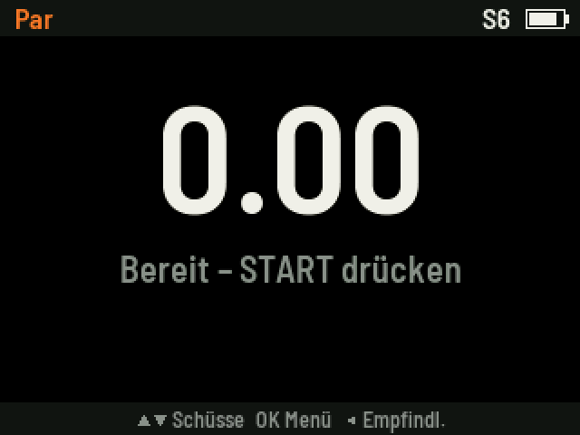 | 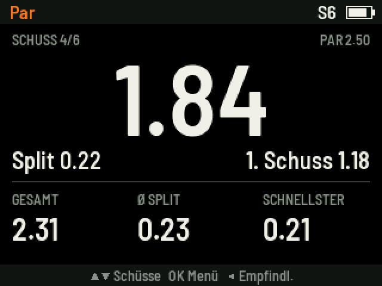 | 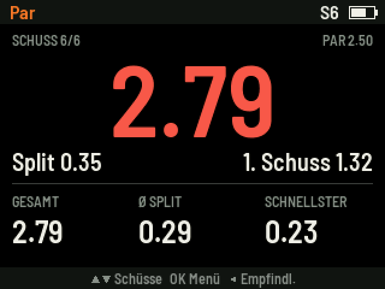 |
| 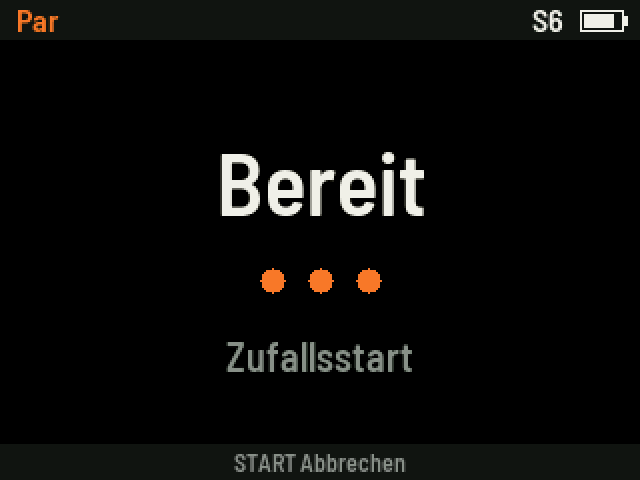 | 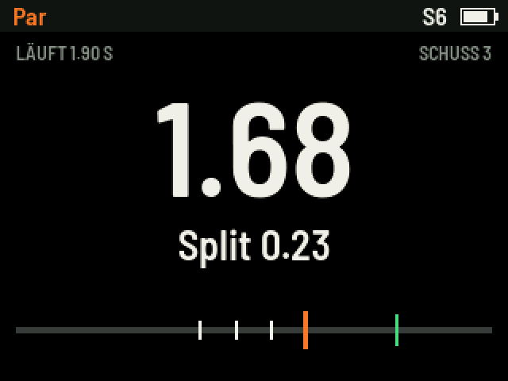 | 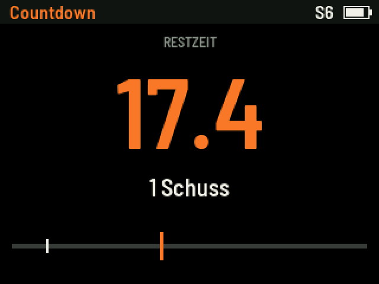 |
| 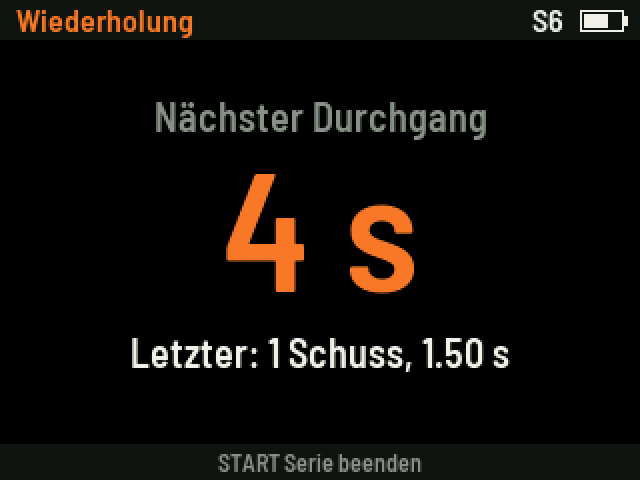 | 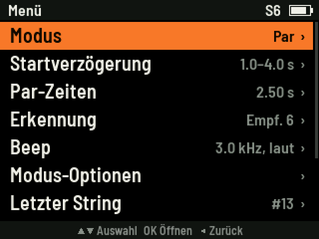 | 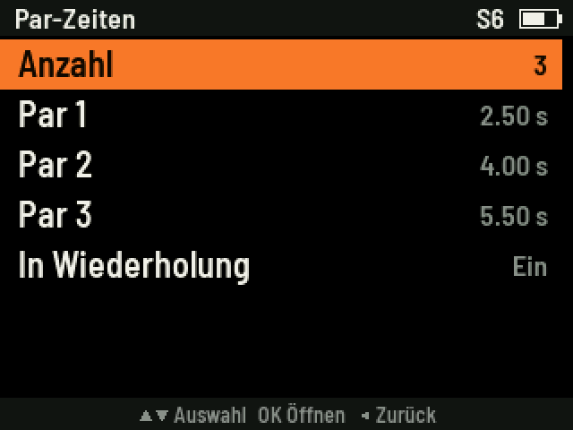 |
| 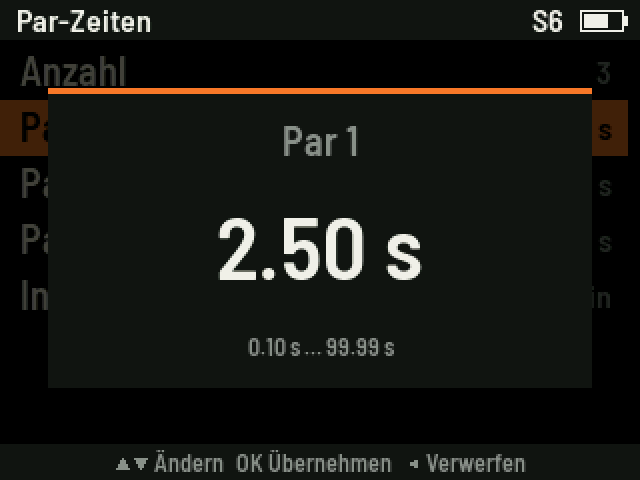 | 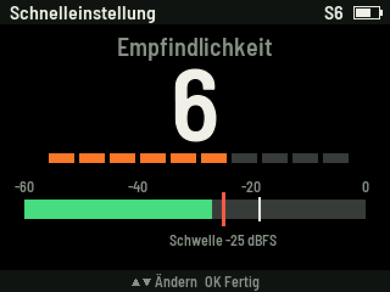 | 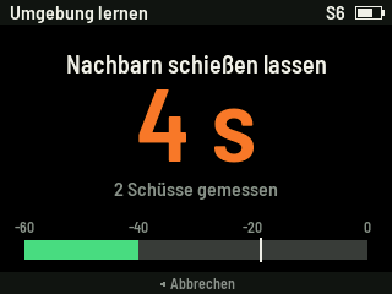 |
| 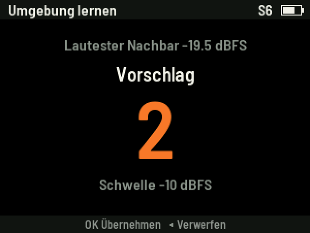 | 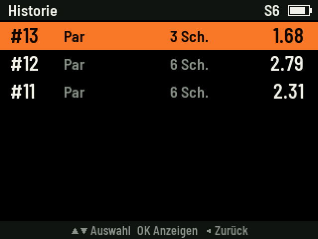 | 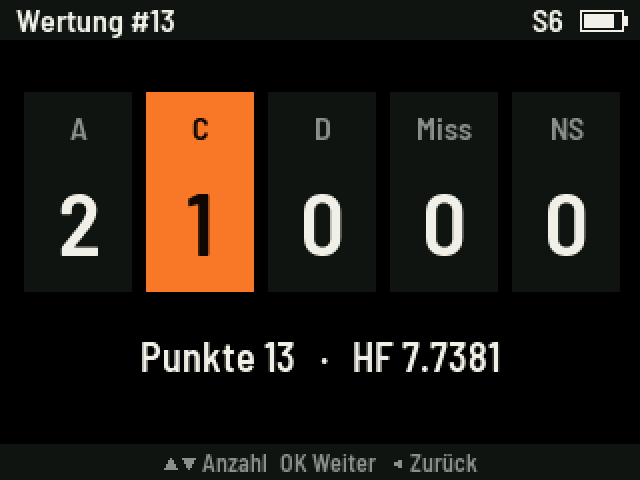 |
| 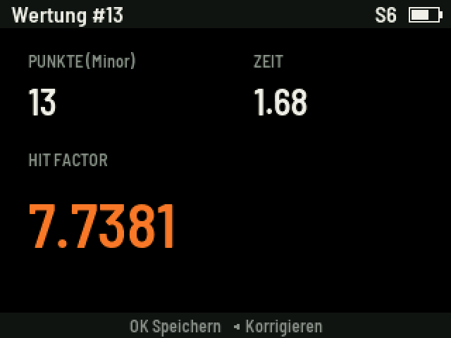 | 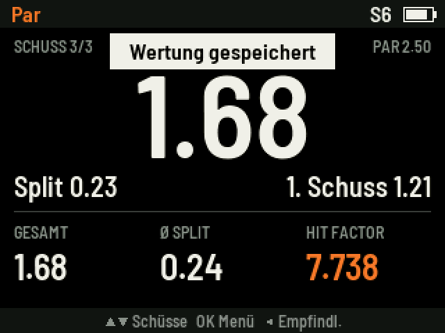 | 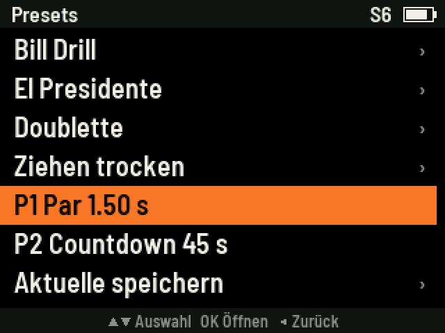 |

## Aufbau

Läuft auf dem Steckbrett aus Phase 1 + 2 ([SCHALTPLAN_PROTOTYP.md](../../docs/SCHALTPLAN_PROTOTYP.md)) plus:

- **Display** (2,0" IPS, ST7789, 240 × 320, SPI) nach Kap. 4.2: SCL → GPIO 12, SDA → 11, CS → 10, DC → 9, RES → 8, BLK → 7, VCC → 3V3, GND.
- **Tasten** nach Kap. 4.3: START → GPIO 14, ▲ → 15, ▼ → 16, OK → 17, ◄ → 18, jeweils gegen GND.

Ohne eigene START-Taste wirkt die Taste **BOOT** des DevKits als START. Nicht beim Einschalten drücken, sonst startet der ESP32 im Programmiermodus.

**Bild gespiegelt, gedreht oder falsche Farben?** Die Module unterscheiden sich. In `src/hal/display.c` oben `LCD_MIRROR_X`, `LCD_MIRROR_Y` bzw. `LCD_INVERT` umstellen und neu flashen.

## Bauen und Flashen

Wie die Mess-Firmware: VS Code mit PlatformIO, Ordner `firmware/timer` öffnen, **Upload**. Danach den **Monitor** öffnen (115200 Baud).

Die beiden Firmwares teilen den Flash unterschiedlich auf. Nach dem Wechsel von der Mess- zur Timer-Firmware sind die gespeicherten Messdaten nicht mehr lesbar. Vorher auslesen (`mess_logger.py download`). Umgekehrt bleibt die Historie der Timer-Firmware nur erhalten, solange keine andere Firmware den Flash überschreibt.

## Bedienung

Am Gerät wie im [UI-Prototyp](../../docs/ui-prototyp.html): START startet bzw. stoppt (2 s halten: aus), ▲▼ blättert durch die Schüsse, OK öffnet das Menü, ◄ öffnet die Schnelleinstellung der Empfindlichkeit (1 s halten: zurück zum Hauptbildschirm).

## Konsole (Test und Protokoll)

Parallel gibt die Firmware alles über die serielle Konsole aus und nimmt Befehle an. START drücken (oder `g` eingeben) startet einen String. Ausgabe:

```
STATE,Verzoegerung
STATE,Lauf
SHOT,1,1.18,1.18,-4
SHOT,2,1.41,0.23,-5
STRING,3,Par,2,1.18,1.41,0.23,0.23,START
STATE,Bereit
```

`STRING`: Nummer, Modus, Schüsse, erster Schuss, Gesamtzeit, schnellster Split, Ø-Split, Grund für das Ende.

| Befehl | Wirkung |
|---|---|
| `h` | Hilfe |
| `s` | Einstellungen anzeigen |
| `g` | wie START |
| `l` | letzten String anzeigen |
| `m 0`…`m 5` | Modus: 0 Standard, 1 Par, 2 Spy, 3 Trockentraining, 4 Wiederholung, 5 Countdown |
| `e 1`…`e 10` | Empfindlichkeit (10 = am empfindlichsten) |
| `d r 1 4` / `d f 3` / `d i` | Zufallsstart 1–4 s / fest 3 s / sofort |
| `p 2.5` / `p 1.5 3 4.5` | eine bzw. mehrere Par-Zeiten in s |
| `a 5` | Auto-Stopp nach 5 s ohne Schuss (0 = aus) |
| `o 50` | Echo-Zeit in ms |
| `c 30 10` | Countdown 30 s, Warnung 10 s vor Ende |
| `r 5` | Pause zwischen Durchgängen (Wiederholung, Trockentraining) |
| `n 10` | Anzahl Durchgänge Trockentraining |
| `b 3000 300 2` | Beep: Frequenz, Dauer, Lautstärke 0–2 |
| `w` | Werkseinstellungen |
| `H` | die letzten 10 Strings der Historie |

Änderungen werden sofort gespeichert und gelten ab dem nächsten String.

## Tests und Werkzeuge

Kern (`src/core`) und Bedienoberfläche (`src/ui`) sind plattformunabhängig und werden am PC getestet:

```
make -C firmware/timer/test            # Tests für Kern und UI
make -C firmware/timer/test screens    # Bildschirme als PNG nach docs/ui-screens (braucht Pillow)
python tools/make_font.py              # Schriften neu erzeugen (braucht Pillow und fonttools)
```

Schrift: Barlow Semi Condensed (SIL Open Font License, `fonts/OFL.txt`).
